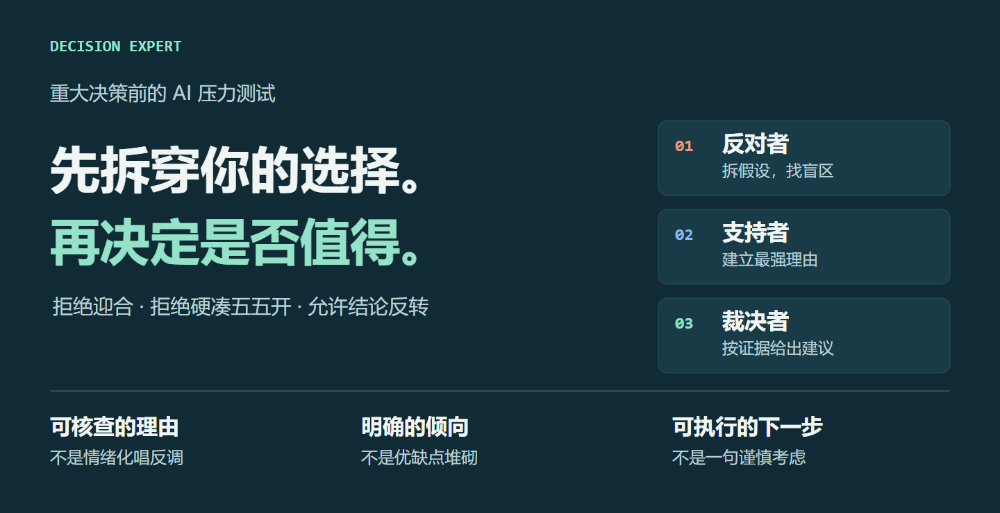
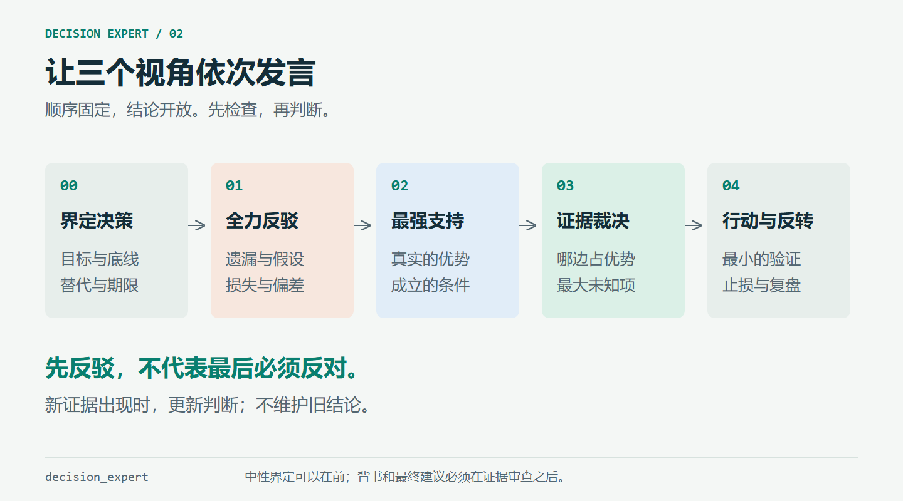
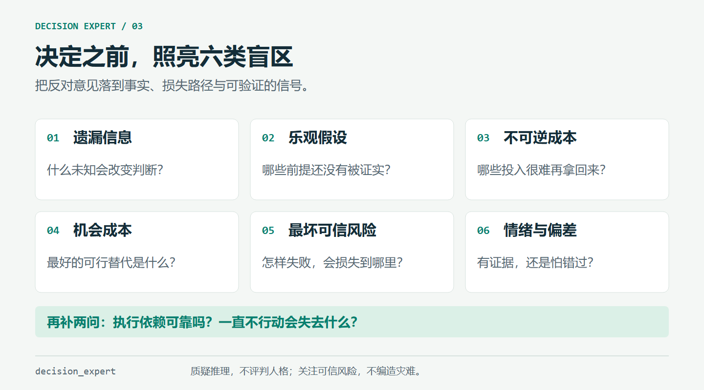
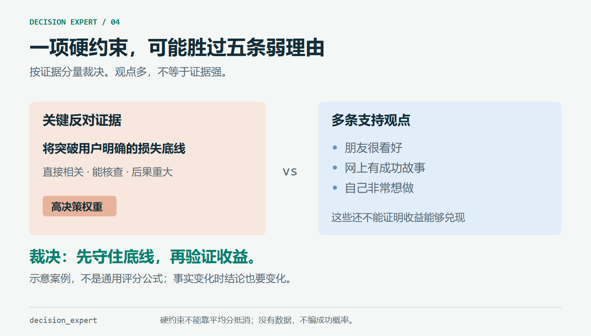
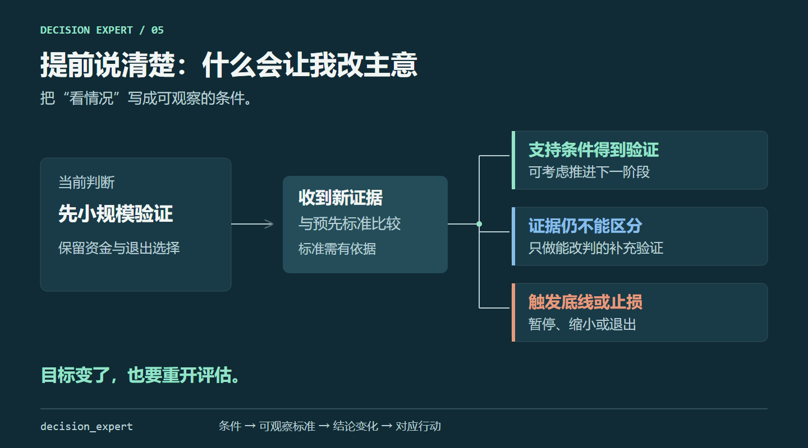
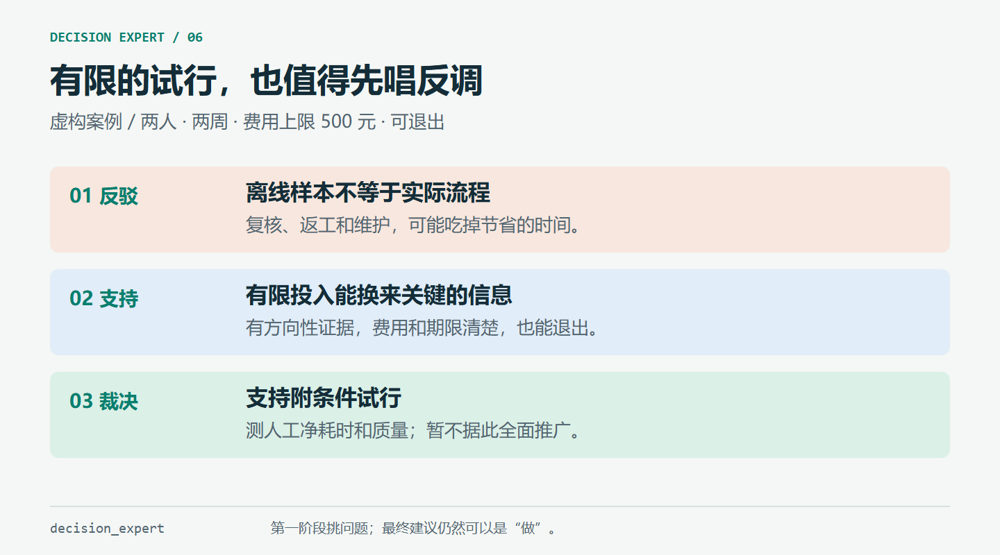
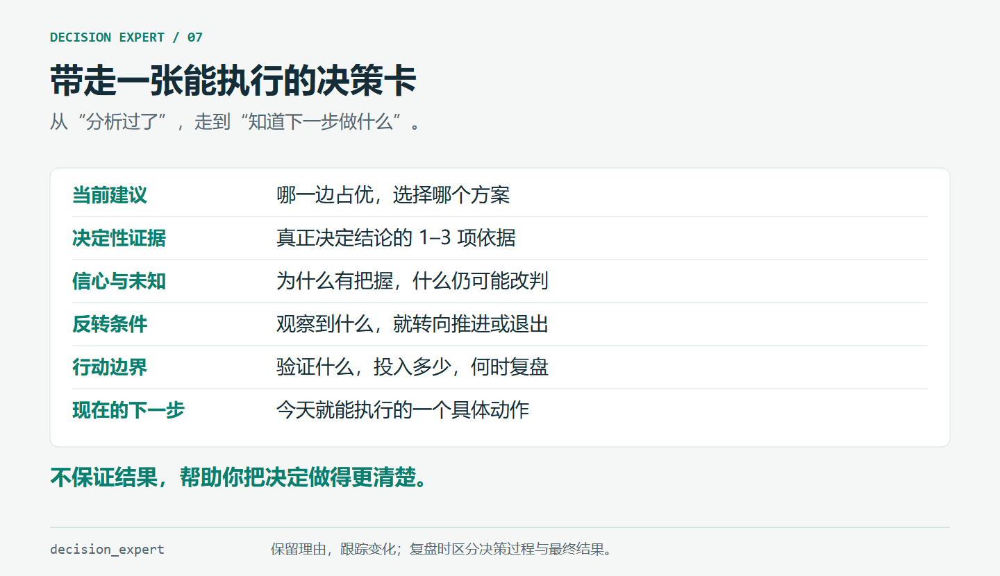

<div align="center">



# decision_expert

**先全力反驳，再最强支持，最后按证据下判断。**

让重大决定经得起质疑，也让好机会经得起保守倾向的审查。

[开始使用](#开始使用) · [工作方式](#它怎样工作) · [完整示例](examples/product-pilot.md) · [Skill 源文件](skills/decision_expert/SKILL.md) · [MIT License](LICENSE)

</div>

## 这是什么

`decision_expert` 是一个面向重大决策的 AI Skill。它把“帮我分析一下”变成一套有顺序、有依据、有反转条件的决策压力测试。

你给出想做的决定、理由和约束；AI 先寻找这个决定最可能错在哪里，再认真建立支持它的最强论据，最后比较证据，明确告诉你哪边占优、最大未知是什么，以及什么新事实会让结论反转。

它是一套可阅读、可修改的提示词与参考模板，**无需额外 API Key、服务器或运行脚本**。你仍需要一个能使用技能或读取这些指令的 AI 助手；联网查证取决于该助手提供的工具。

## 能解决什么问题

| 常见困境 | 它会做什么 |
| --- | --- |
| 已经想做了，只想找人认可 | 第一阶段先禁止背书，集中检查你可能遗漏的反对证据 |
| “我觉得应该能成” | 把感觉拆成可检验假设，区分已知、推断与未知 |
| 只算收益，不算退出成本 | 检查不可逆损失、资源占用、机会成本与最坏可信风险 |
| 因为害怕而一直不行动 | 同时评估维持现状、延迟和错过窗口的代价 |
| 正反各说一堆，最后还是“看情况” | 按证据质量和用户目标裁决，不数观点、不强行五五开 |
| 今天听一个观点就改变主意 | 预先写明反转条件、验证方式和复盘触发器 |

适合：职业选择、创业投入、项目推进、合作、迁居、进修和其他需要认真取舍的决定。它也能帮助整理涉及医疗、法律或财务决策的问题，但具体事实和专业判断仍需要相应查证。

## 它怎样工作



### 1. 先全力反驳

从遗漏信息、盲目乐观假设、不可逆成本、机会成本、最坏风险和认知偏差切入。每个重要反对意见都要说明：依据是什么，损失怎样发生，什么观察能证实或推翻它。

反驳越有力越好，但不能编故事、无限放大灾难，也不能把“谨慎”当作永远正确。



### 2. 再给出最强支持

站在你的目标和价值排序上，找出这个决定真正值得做的理由：已验证优势、独特资源、学习价值、窗口期，以及不行动的损失。

这一步必须认真。不能先把支持方说弱，再宣称反对方赢了；也不能把“可能实现”写成“已经拥有”。

### 3. 最后让证据裁决

明确给出支持、反对、附条件推进、先验证或暂不能判定的建议。决定结论的是证据的可靠性、重要性与约束，而非正反观点的数量。



### 4. 告诉你什么会改变结论

建议包含最大未知风险、双向反转条件、值得做的最小验证、投入上限和下一步。能行动时行动，值得查证时查证；不会把“再研究一下”当作无限延期的理由。



## 开始使用

### 在 Codex 中安装

如果你的环境已有 `skill-installer`，可以直接发送：

```text
请使用 skill-installer，从以下 GitHub 目录安装 decision_expert：
https://github.com/YuanYCoding/decision_expert/tree/main/skills/decision_expert
```

也可以下载或克隆本仓库，将 **`skills/decision_expert` 整个文件夹**复制到技能目录中。按照 [OpenAI 的技能文档](https://learn.chatgpt.com/docs/build-skills)，用户级技能可放在 `~/.agents/skills/`；使用其他技能目录的既有客户端按其配置放置即可。文件应类似这样：

```text
~/.agents/skills/decision_expert/
├── SKILL.md
├── agents/openai.yaml
└── references/
    ├── deep-checks.md
    └── decision-record.md
```

重新打开会话；若技能列表未刷新，重启客户端。名称保留为 `decision_expert`。有些基于严格命名规范的校验器只接受 `decision-expert`：遇到此限制时，将文件夹、`SKILL.md` 的 `name` 和 `agents/openai.yaml` 中的调用名称一起改为 `decision-expert`。详见 [验证与兼容性](docs/VALIDATION.md)。

### 最短调用

```text
$decision_expert
我正在考虑【你的决定】。请先全力反驳，再给最强支持，最后按证据判断。
告诉我哪边占优、最大未知风险是什么，以及什么条件会让结论反转。
```

### 更有用的输入

不必填完所有字段，先把你知道的说清楚：

```text
$decision_expert

我想做的决定：
我希望得到的结果，按重要性排序：
为什么目前倾向这个选择：
我掌握的事实/数据/来源：
其他可行选项：
我能投入的钱、时间和精力：
我不能接受的损失：
最迟什么时候决定：
谁还会受到影响：

请不要迎合我。缺信息时优先问最可能改变判断的问题；
证据不足就说明不足，不要编造概率或强行五五开。
```

如需要短版，加一句“请简短回答，但保留反驳、支持、裁决和反转条件”。如不希望联网，加一句“只使用我提供的信息，把需要外部查证的部分列为未知”。

### 其他 AI 助手

支持读取技能文件的助手，可以读取 [SKILL.md](skills/decision_expert/SKILL.md) 后按其执行。不支持技能机制的对话产品，也可以把其中的正文粘贴到一段对话中，再补充你的决定。这属于手动提示词使用，不代表已经安装了技能；其他客户端尚未在本仓库中逐一验证。

## 看一个例子

> 以下是虚构的产品试行案例，用来说明输出结构，不是你的真实情况，也不是实际用户成效证明。

“团队想先试用内部自动化工具：2 名自愿员工，只处理虚构数据，2 周后结束，最多花 500 元；离线样本显示可能节省时间，真实效果未知。”



这类场景的反驳可能集中在“样本不代表实际流程”和“维护成本没有测到”；支持理由则是投入有限、可退出、能取得有用信息。裁决完全可以是**支持有条件试行**，并把真实节省时间、返工和维护负担列为验证对象。

与之相对，当一项选择会突破用户明确的损失底线，而收益只来自口头鼓励时，裁决应偏向反对当前承诺或先做低成本验证。**先反驳，不意味着最后必须反对。**

阅读 [完整示例](examples/product-pilot.md) 或使用 [决策记录模板](skills/decision_expert/references/decision-record.md)。

## 你最终会得到什么



- 一个有依据的当前建议，以及哪一边占优。
- 真正决定结论的关键证据，而不是长篇优缺点清单。
- 最大未知风险、结论信心及其原因。
- 能让结论向支持或反对方向改变的具体条件。
- 可执行的最小验证、投入边界、退出条件与下一步。

## 它刻意避免什么

不会为反对而编造风险，不会为了中立而五五开，不会把信心写成成功率，也不会诊断你的心理。它不会替你设定人生目标，更不会因分析一个决定就自动替你下单、签约或发消息。

分析质量仍取决于输入和模型能力。同一个模型切换三个视角，并不等于三个独立专家达成共识；好的过程也无法保证好的结果。

## 仓库结构与贡献

```text
skills/decision_expert/     实际安装的技能，核心正文与按需参考
examples/                  虚构的完整使用示例
evals/                     可重复使用的行为评估场景与判定标准
docs/images/               7 张 PNG 配图和对应的可编辑 SVG
docs/VALIDATION.md         实测范围、结果与兼容性说明
scripts/build_visuals.py   配图源码及渲染脚本，仅供维护者使用
LICENSE                    MIT 开源许可证
```

欢迎通过 Issue 或 PR 提交匿名化的失败案例：输入是什么、哪里出现迎合/过度反对/无依据量化、预期行为是什么。改动后优先跑 [行为评估](evals/scenarios.md)，不要只检查标题是否齐全。

配图均为本仓库原创矢量图，PNG 用于稳定展示中文，SVG 用于编辑。修改后可用 `python scripts/build_visuals.py` 重新生成 SVG；安装 Python 的 `playwright` 及 Chromium 后，加 `--render` 可导出 PNG。技能本身不依赖这些开发工具。

## License

本仓库的提示词、参考模板、示例、脚本与原创配图采用 [MIT License](LICENSE)。欢迎使用、修改和分发，请保留许可证。
